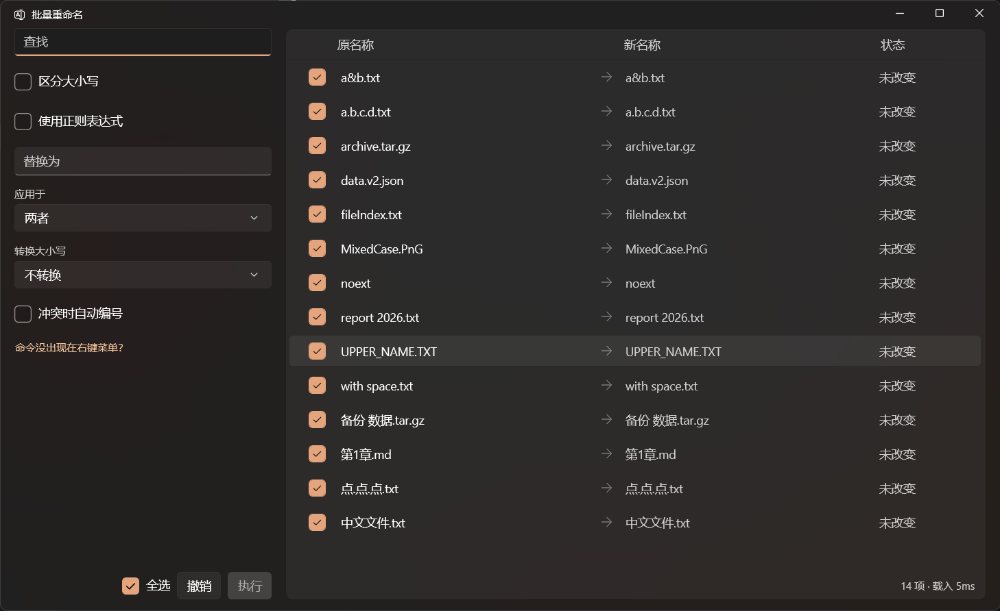

# 批量重命名 v1.0.0

Windows 11 资源管理器右键菜单里的批量重命名工具。

选中一批文件 → 右键「批量重命名」→ 实时预览「原名 → 新名」→ 执行。
改名前能看见每一项会变成什么，改完能一键撤回。

## 下载

| 文件 | 大小 | 说明 |
|---|---|---|
| `BatchRename-Setup-<日期>.exe` | 96.5 MB | **推荐**。双击安装，自带 .NET 运行时，可选择安装位置 |
| `BatchRename-<日期>.zip` | 60.5 MB | 绿色版。解压后双击 `安装.cmd`，需自备 .NET 10 Desktop Runtime |

## 系统要求

| 项 | 要求 |
|---|---|
| Windows | 11 22H2（Build 22621）或更高 |
| 架构 | x64 |
| 开发者模式 | **必须开启**（安装程序会检查并拦截） |
| .NET | 安装包自带；绿色版需 .NET 10 Desktop Runtime (x64) |

开启开发者模式：设置 > 系统 > 开发者选项 > 开发人员模式。

## 功能

- **查找替换**：纯文本或正则，可区分大小写
- **作用域**：只改主名 / 只改扩展名 / 整个文件名
- **大小写转换**：全大写、全小写、每词首字母大写
- **实时预览**：逐行标注状态（未改变 / 可执行 / 冲突 / 非法）
- **冲突处理**：默认红字阻止；勾选「冲突时自动编号」则改成 `a (1).txt`
- **逐项勾选**：只改想改的项，支持全选
- **两条撤销通路**：软件内撤销（管最近一批）+ 资源管理器 `Ctrl+Z`（整批退回，程序关闭后仍有效）
- **单实例**：重复右键不会开出多个窗口

## 使用

1. 选中文件 → 右键 → **批量重命名**
2. 左栏填规则，右栏看预览
3. `Enter` 执行，`Ctrl+Z` 撤销

快捷键：`Enter` 执行、`Esc` 关闭、`Ctrl+A` 全选、`Space` 切换当前行、`↑↓` 移动。

**菜单项没出现？** 26H2 默认把第三方扩展收进「应用扩展」子菜单。右键菜单最底部有「自定义菜单」按钮可直达设置；或直接用「发送到 > 批量重命名」。

## 安全设计

- 目标名已存在时**默认阻止**，不会静默覆盖
- 批内循环改名（`a→b` 同时 `b→a`）在预览阶段拦下
- 链式改名（`a→b`、`b→c`）按依赖顺序执行
- 每次执行前写事务日志，中途崩溃下次启动会提示回滚
- 改名通过 Windows `IFileOperation`，与资源管理器自身改名同一路径

## 已知限制

- 不支持递归子文件夹
- 不支持拖放文件到窗口
- 软件内撤销只保留最近一批
- 不支持云盘占位文件、回收站等虚拟项

## 技术栈

- UI：WinUI 3 + Windows App SDK 2.6.4（.NET 10）
- Shell 扩展：C++ / WRL，实现 `IExplorerCommand`，稀疏包注册
- 执行：`IFileOperation` + `IFileOperationProgressSink`（逐项 HRESULT）
- 撤销：单文件事务日志（`last-batch.json`）+ Shell 撤销栈（`FOFX_ADDUNDORECORD`）
- 测试：124 项自动断言，xUnit 与控制台双入口共用同一份实现
- CI：GitHub Actions（windows-latest）

## 许可

MIT
